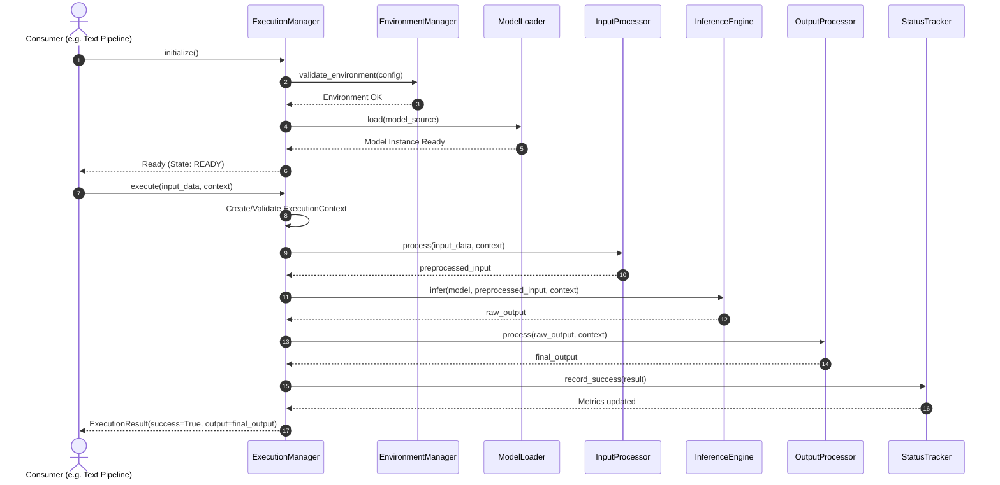
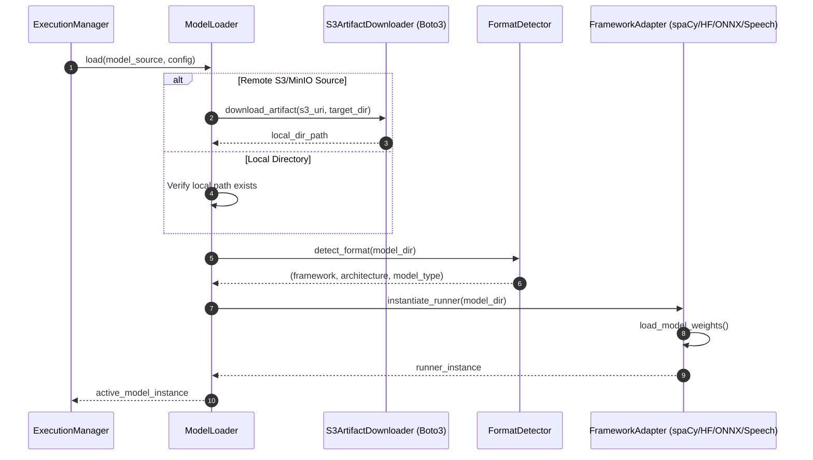
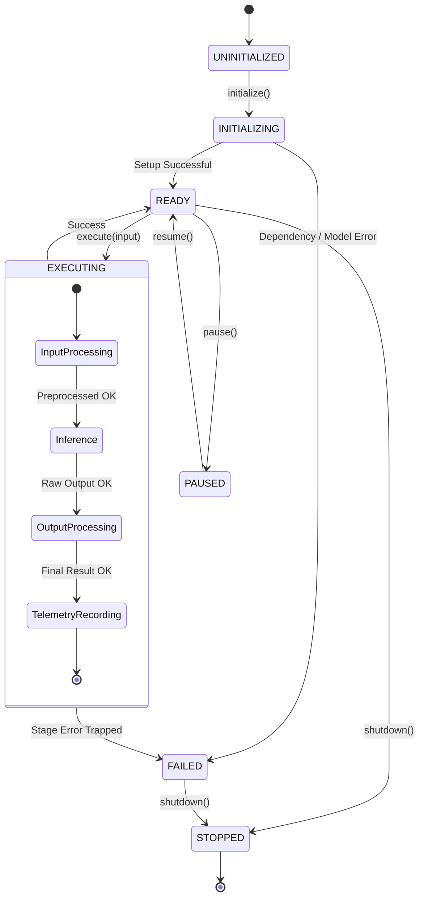
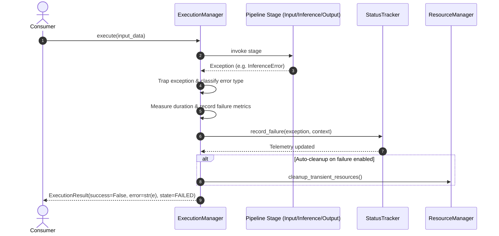
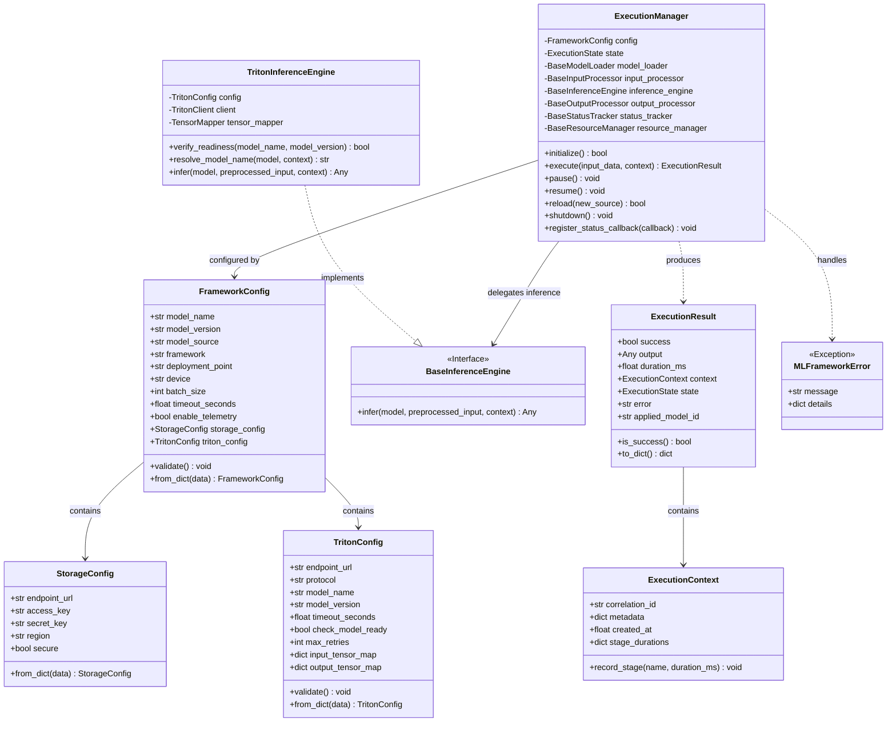
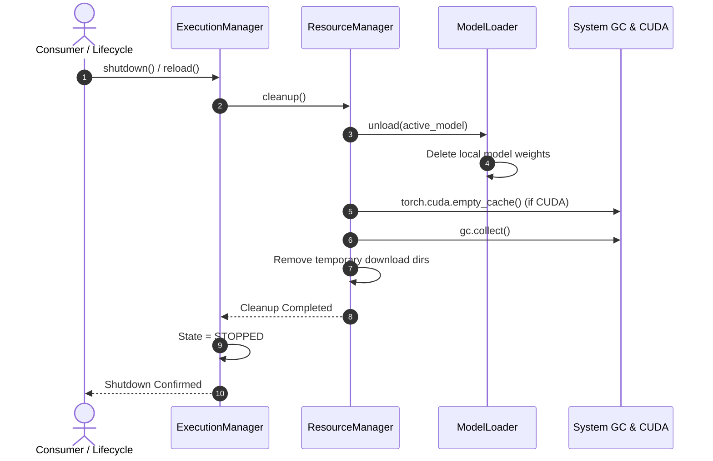
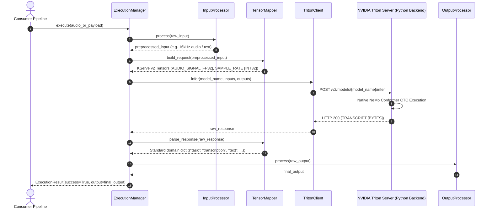

# ML Framework — Architectural Specification & Sequence Reference

This document formalizes the architecture of the `ml_framework` package based on the six approved design authority diagrams:
1. **Successful Execution Sequence**
2. **Model Loading Sequence**
3. **Execution Flow**
4. **Error Handling Sequence**
5. **Class Diagram**
6. **Resource Cleanup Sequence**

---

## 1. Successful Execution Sequence

Illustrates the end-to-end execution flow when an input payload is processed successfully without errors.



---

## 2. Model Loading Sequence

Illustrates dynamic model resolution, artifact downloading (via Boto3 for S3/MinIO), format detection, and adapter instantiation.



---

## 3. Execution Flow

Illustrates the internal state transitions and latency tracking across lifecycle stages inside `ExecutionManager`.



---

## 4. Error Handling Sequence

Illustrates centralized error trapping, typed classification, and safe caller notification.



---

## 5. Class Diagram

Defines the core class relationships, configuration structures, and interfaces.



---

## 6. Resource Cleanup Sequence

Illustrates resource deallocation, memory release, and temporary artifact purge during model switching or shutdown.



---

## 7. Offline Installation & Dependency Boundaries

To support secure air-gapped or restricted offline environments:

1. **Zero Base Dependencies:**
   - The core package foundation (`ml_framework.execution_manager`, `config`, `results`, `errors`, `interfaces`) relies strictly on standard library Python modules (`dataclasses`, `enum`, `typing`, `time`, `uuid`, `logging`, `abc`).
2. **Offline Installation:**
   - Standard editable install: `pip install --no-index --find-links=/path/to/local_wheels -e /home/apeksha-ssi021/Shyena/ml_framework`
   - Build wheel offline: `python3 -m pip wheel --no-deps /home/apeksha-ssi021/Shyena/ml_framework -w ./dist`
3. **Optional Framework Extras:**
   - Heavy dependencies are segregated into `extras_require`:
     * `ml-framework[storage]`: `boto3`
     * `ml-framework[spacy]`: `spacy`
     * `ml-framework[transformers]`: `transformers`, `torch`
     * `ml-framework[onnx]`: `onnxruntime`, `optimum`
     * `ml-framework[speech]`: `soundfile`, `transformers`, `torch`

---

## 8. Public API Facade (`from ml_framework import ml`)

To provide an intuitive, high-level developer experience without breaking lower-level contracts:

```python
from ml_framework import ml

# 1. Load model with automatic pre-validation and environment checks
model = ml.load(
    model_source="minio://models/ner.tar.gz",
    input_source="/path/to/documents.jsonl",
    framework="transformers",
    device="cpu"
)

# 2. Process inputs dynamically
result = model.process(input_data="Sample raw text payload")
if result.success:
    print("Inference output:", result.output)
else:
    print("Execution failed:", result.error, result.error_type)

# 3. Model lifecycle management
model.unload()  # Frees model memory; transitions state to UNINITIALIZED
model.stop()    # Completely shuts down the manager and releases all resources
```

---

## 9. Input Processing Subsystem (Task 1)

The input subsystem abstracts data ingestion behind the `BaseInputReader` contract, supporting multi-source reading, early configuration validation, and chunked streaming:

```text
                  +-------------------------+
                  |     InputProcessor      |
                  +-------------------------+
                               |
            +------------------+------------------+
            |                  |                  |
+--------------------+ +--------------------+ +--------------------+
|   LocalFileReader  | | ObjectStorageReader| |  KafkaTopicReader  |
| (file://, /path)   | |(SeaweedFS/MinIO/S3)| |  (kafka://topic)   |
| - Chunked stream   | | - Boto3 S3 stream  | | - Batch polling    |
| - Line generators  | | - iter_chunks()    | | - Auto offset      |
+--------------------+ +--------------------+ +--------------------+
```

### Key Capabilities:
- **Pre-Loading Validation:** Validates that input paths exist, object storage keys are present, and Kafka topic names are valid *before* triggering expensive model downloading and instantiation. If invalid, the manager fails early and cleans up gracefully.
- **Memory Safety via Chunking:** Large files and remote streams are read in configurable byte chunks (`chunk_size`) or line batches (`batch_size`) using Python generators. Multi-gigabyte files are never buffered into RAM all at once.
- **Object Storage Support (SeaweedFS / MinIO):** Implemented via standard S3 protocol using Boto3, parsing `seaweedfs://`, `minio://`, and `s3://` URIs.
- **Mockable Architecture:** All readers support dependency injection of mock clients (mock S3, mock Kafka consumer) for unit testing without live services.

---

## 10. Environment Management Subsystem (Task 2)

The `EnvironmentManager` enforces runtime dependency and hardware device integrity in strictly offline environments:

### Key Capabilities:
- **Model Metadata Inspection:** Inspects model directories (`config.json`, `meta.json`, `config.cfg`, `.onnx` presence) and framework configurations to automatically determine exact library requirements (`torch`, `transformers`, `spacy`, `onnxruntime`, `soundfile`, `boto3`, `confluent_kafka`).
- **Offline Dependency Verification:** Utilizes `importlib.util.find_spec` to verify installed packages locally. Does **not** download packages, invoke `pip`, or query external networks.
- **Clear Error Reporting:** When dependencies are missing, raises `DependencyMissingError` with exact missing package names and a ready-to-run offline installation command (`pip install --no-index --find-links=/path/to/wheels ...`).
- **Hardware Compatibility Checking:** Validates device placement (`cpu`, `cuda`, `mps`). Queries CUDA/MPS availability safely and rejects incompatible device requests early with `HardwareIncompatibleError`.

---

## 11. Exclusive Inference Engine: NVIDIA Triton Inference Server (Option B)

In production environments, `ml_framework` enforces **NVIDIA Triton Inference Server as the exclusive engine** for executing model predictions. Direct local model execution (e.g., executing forward passes directly via local Python model adapters) is disabled in the production pipeline.



### Key Capabilities & Option B Serving:
1. **Option B Direct NeMo Serving:** Serves native `.nemo` checkpoints directly using Triton's Python backend (`nemo_conformer_python`), completely bypassing ONNX conversion and eliminating ONNX Runtime dependencies.
2. **Zero-External-Dependency HTTP Client:** `TritonClient` implements the KServe v2 REST protocol over standard Python `urllib.request`, ensuring complete operability in air-gapped environments without requiring `tritonclient` wheels.
3. **Model Decoupled Tensor Mapping:** `TensorMapper` translates arbitrary framework inputs (audio bytes, waveforms, dictionaries, text) into typed KServe tensors and normalizes Triton responses back into domain-specific outputs.
4. **Direct Execution Protection:** `ExecutionManager._run_inference()` strictly blocks direct invocation of `model_instance.predict()`: any attempt to execute local adapter prediction without Triton raises `InferenceError`.
5. **Fail-Fast Readiness Checks:** `ExecutionManager.initialize()` validates Triton server health (`/v2/health/ready`) and model readiness (`/v2/models/{name}/ready`) during startup before accepting pipeline traffic.


